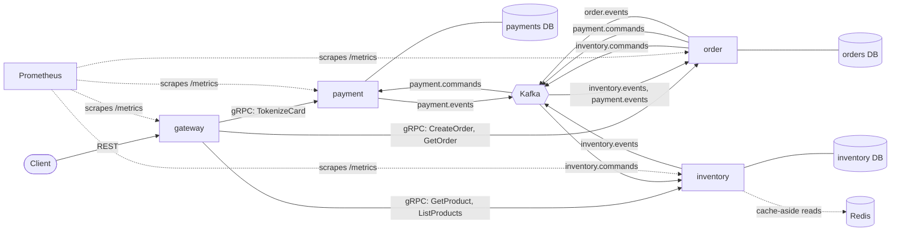
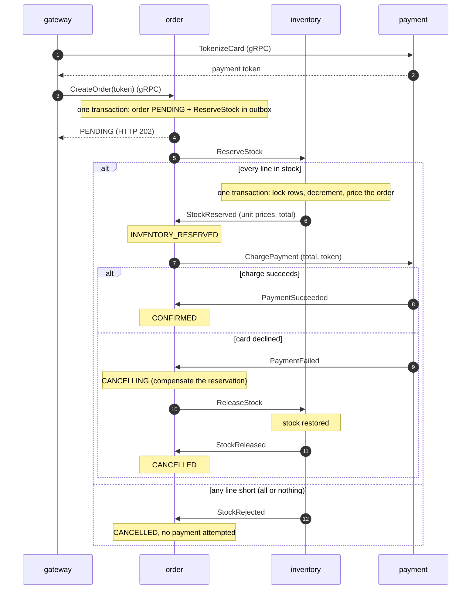

[](https://github.com/omnomkar/event-driven-orders/actions/workflows/ci.yml?query=branch%3Amain)

# Event-Driven Order Platform

Four Go services (a REST gateway plus order, payment, and inventory) that place an order across three databases without a distributed transaction. The order service orchestrates a saga over Apache Kafka: inventory reserves stock and prices the order, payment charges a tokenized card, and a failure at any step is compensated. Every state change is published through a transactional outbox, every consumer deduplicates by message ID, and failed messages are retried with backoff and then dead-lettered, so at-least-once delivery produces exactly one effect per order. The project includes a chaos test that kills the payment service mid-run, a Redis cache for catalog reads, Prometheus metrics, and a k6 load test with saved results.

## Highlights

- **Exactly one charge per order under failure:** across 5 chaos runs, 580 orders all confirmed with zero duplicate charges, with the payment service killed by SIGKILL mid-run each time ([reports](scripts/results/)).
- **Load test:** 380.40 requests per second with 0 errors out of 79,898 requests, at p99 3.71 ms for reads and 39.16 ms for order creation (k6 ramp to 50 virtual users, cache on, one laptop; [results](loadtest/results/README.md)).
- **Chaos in CI:** a 200-order chaos run executes in CI on every push and pull request, alongside the unit, integration, and end-to-end tests.

## Architecture



- The gateway is the only public entry point. It tokenizes the card through payment before creating the order, so only an opaque token reaches the order service, its database, and Kafka.
- Each service owns its database (one Postgres instance, three databases, one login role each that can connect only to its own). Services never read each other's tables; they coordinate only through Kafka.
- Every topic is keyed by order ID, so one order's messages stay in order on one partition. Each topic has a `.dlq` twin (10 topics, 3 partitions each).
- Each service writes outgoing messages to an `outbox` table in the same transaction as its state change; a relay publishes them.

### Saga



From ReserveStock on, every arrow is a Kafka message written through an outbox and handled by a consumer that records its `message_id` in the same transaction as its effect.

## Tech stack

| Area | Choice |
| --- | --- |
| Language | Go 1.27, one module per service plus `pkg` and the generated code |
| Service to service | gRPC and Protocol Buffers, generated with buf |
| Public API | REST on `net/http` (Go 1.22+ routing patterns) |
| Messaging | Apache Kafka 4.3 in KRaft mode, Protobuf payloads, franz-go client |
| Databases | PostgreSQL 18 with pgx, goose migrations embedded in each binary |
| Cache | Redis 8 (go-redis), catalog reads only |
| Observability | Prometheus (`client_golang`), structured JSON logs with `log/slog` and `order_id` on every order line |
| Testing | `go test`, testcontainers-go, bash chaos script, k6 |
| Local runtime | Docker Compose; distroless, non-root images |
| CI | GitHub Actions |

## Running it locally

Requirements: Docker with Compose, GNU make, curl. Go 1.27 and buf are needed only to run tests or regenerate code.

```bash
make up       # build the images and start everything, waiting until healthy
make ready    # /readyz on every service, plus the database role isolation check
make metrics  # place one order and check the saga metrics and Prometheus targets
make down     # stop and delete the containers and volumes
```

`make up` copies `deploy/compose/.env.example` to `.env` on first use (local development passwords only). The gateway listens on `localhost:8080`, Prometheus on `localhost:9090`, and each service's admin port (`/healthz`, `/readyz`, `/metrics`) on 8081 (order), 8082 (payment), and 8083 (inventory).

### Example requests

Only standard test card numbers work. `4242 4242 4242 4242` is charged, and `4000 0000 0000 0002` is always declined.

```bash
# Browse the catalog
curl -s localhost:8080/products
curl -s localhost:8080/products/sku-keyboard

# Place an order: 202 Accepted with the PENDING order
curl -s -X POST localhost:8080/orders -H 'Content-Type: application/json' -d '{
  "customer_id": "alice",
  "items": [{"product_id": "sku-keyboard", "quantity": 1}, {"product_id": "sku-cable", "quantity": 2}],
  "card": {"number": "4242 4242 4242 4242", "exp_month": 12, "exp_year": 2030}
}'

# Poll it: PENDING, then INVENTORY_RESERVED, then CONFIRMED (usually within a second)
curl -s localhost:8080/orders/<order_id>

# Declined card: the reservation is released and the order ends CANCELLED ("card declined")
curl -s -X POST localhost:8080/orders -H 'Content-Type: application/json' -d '{
  "customer_id": "alice",
  "items": [{"product_id": "sku-monitor", "quantity": 1}],
  "card": {"number": "4000 0000 0000 0002", "exp_month": 12, "exp_year": 2030}
}'

# Out of stock: CANCELLED with no payment attempt (sku-soldout has 0 units)
curl -s -X POST localhost:8080/orders -H 'Content-Type: application/json' -d '{
  "customer_id": "alice",
  "items": [{"product_id": "sku-soldout", "quantity": 1}],
  "card": {"number": "4242 4242 4242 4242", "exp_month": 12, "exp_year": 2030}
}'

# Idempotency-Key: the first request is 202; repeating it returns the same order with 200
# and charges once. Reusing the key with different items is 409 Conflict.
for i in 1 2; do
  curl -s -o /dev/null -w '%{http_code}\n' -X POST localhost:8080/orders \
    -H 'Content-Type: application/json' -H 'Idempotency-Key: alice-cart-42' -d '{
    "customer_id": "alice",
    "items": [{"product_id": "sku-mouse", "quantity": 1}],
    "card": {"number": "4242 4242 4242 4242", "exp_month": 12, "exp_year": 2030}
  }'
done
```

### Failure tooling and load test

```bash
make chaos                        # kill payment mid-run, check exactly one charge per order
make dlq                          # list every dead-letter record with its error and source
make dlq-replay TOPIC=payment.commands.dlq   # send them back once the cause is fixed
make loadtest CACHE=on            # k6 ramp test with the catalog cache on (or CACHE=off)
```

`make chaos` takes `CHAOS_ORDERS` and `CHAOS_CONCURRENCY` (defaults 50 and 10). `make loadtest` takes `LOADTEST_VUS` (default 50) and the other settings listed in `scripts/loadtest.sh`, and writes its raw output to `loadtest/results/`.

## Testing

| Layer | Command | What it proves |
| --- | --- | --- |
| Unit | `make test` | Saga state machine (every allowed and refused transition), retry backoff math and jitter bounds, retry and dead-letter policy, idempotency request hashing, card validation, config parsing, readiness and degraded checks, cache-aside logic with a fake cache, HTTP and gRPC metric labels, gateway request handling and error mapping |
| Integration | `make test-integration` | Against real Postgres, Kafka, and Redis containers (testcontainers-go): order and outbox rows in one transaction; relay publishes and marks rows sent; concurrent reservations never oversell or deadlock; payment failure releases stock; dedup under 10 concurrent claims; concurrent duplicate Idempotency-Keys create one order; poison messages reach the dead-letter topic and replay works; a reservation invalidates cached stock; reads survive Redis being stopped. The end-to-end test runs the whole Compose stack and drives the happy, declined, out-of-stock, and idempotent paths through the gateway |
| Failure and load | `make chaos`, `make metrics`, `make loadtest` | The chaos script kills payment with SIGKILL while it is charging and checks every order is final with exactly one payment; the metrics check proves Prometheus scrapes every service; the k6 run measures latency and throughput |

CI (`.github/workflows/ci.yml`) runs on every push and pull request: buf lint, format, and generated-code drift; golangci-lint and `go test -race` for each of the seven modules; the integration tests for each module; shellcheck; and a Compose smoke job that builds the images, runs `make ready`, `make metrics`, and a 200-order `make chaos`. Actions are pinned to commit SHAs and the workflow has read-only permissions.

## Results

### Chaos test

Each run places the orders through the gateway, kills the payment container with SIGKILL once it has started charging, keeps it down, restarts it, and waits for every order to finish. Raw reports are in [`scripts/results/`](scripts/results/).

| Run | Orders | Charged at kill | Not final at kill | Payment down | Confirmed | Orders with more than one payment | Redeliveries skipped by dedup | Dead-lettered |
| --- | --- | --- | --- | --- | --- | --- | --- | --- |
| [214348Z](scripts/results/chaos-20261016T214348Z.txt) | 50 | 15 | 47 | 24 s | 50 | 0 | 0 | 0 |
| [214435Z](scripts/results/chaos-20261016T214435Z.txt) | 200 | 26 | 199 | 25 s | 200 | 0 | 25 | 0 |
| [215641Z](scripts/results/chaos-20261016T215641Z.txt) | 30 | 11 | 19 | 23 s | 30 | 0 | 0 | 0 |
| [220830Z](scripts/results/chaos-20261016T220830Z.txt) | 100 | 66 | 66 | 24 s | 100 | 0 | 0 | 0 |
| [221223Z](scripts/results/chaos-20261016T221223Z.txt) | 200 | 2 | 200 | 23 s | 200 | 0 | 0 | 0 |

Across the five runs, 580 orders were placed and 580 were confirmed with exactly one payment each. In the 200-order run at 214435Z, the restarted payment service received 25 charge commands it had already processed and skipped every one by `message_id`. In the run at 221223Z, 2 orders had been charged but their replies were still in payment's outbox at the kill; the relay sent them after the restart.

### Load test

A k6 ramp test (0 to 50 virtual users over 1 minute, held for 2 minutes, down over 30 seconds; about 80% catalog reads and 20% orders, 0.1 s pause per request) ran once with the catalog cache on and once with it off. Full table, definitions, and raw files: [`loadtest/results/`](loadtest/results/README.md).

| Metric | Cache on | Cache off |
| --- | --- | --- |
| Read latency p50 / p95 / p99 (ms) | 1.02 / 2.03 / 3.71 | 0.96 / 1.79 / 3.09 |
| Order creation latency p50 / p95 / p99 (ms) | 5.83 / 13.72 / 39.16 | 5.75 / 12.83 / 28.28 |
| Requests per second | 380.40 | 380.95 |
| Error rate | 0% (0 of 79,898) | 0% (0 of 80,021) |
| Saga duration p95 / p99, exact (ms) | 853 / 914 | 855 / 915 |
| Max consumer lag (order-saga group) | 39 | 62 |
| Cache hit ratio (product / list) | 75.3% / 76.9% | not applicable |
| Orders confirmed, with one payment each | 16,076 | 15,951 |

The cache did not make reads faster in this setup: the catalog is seven rows that Postgres serves from memory, so a database read costs about as much as a Redis round trip, and each committed reservation deletes the cached list and product keys (hit ratio about 76%). Saga time is dominated by the outbox relays polling every 200 ms across four hops, not by Kafka or the consumers. Everything ran on one laptop in WSL2, load generator included, and the stack was not saturated: about 380 requests per second is the load 50 users with a 0.1 s pause generate, not the system's capacity.

## Design decisions

[`docs/decisions.md`](docs/decisions.md) records each decision with the alternative I considered. The five that shape the system most:

1. **Orchestrated saga instead of a distributed transaction.** The order service owns the whole flow in one state table; there is no two-phase commit across three databases and Kafka.
2. **Transactional outbox.** A state change and the message announcing it commit in one Postgres transaction, so a crash can never leave one without the other.
3. **At-least-once delivery with consumer deduplication.** Each consumer records the `message_id` in the same transaction as its effect, so a redelivered message does nothing and every order is charged once.
4. **Inventory owns prices, and the card is tokenized before the saga.** The amount charged is the amount reserved, and no card number ever enters the order service or Kafka.
5. **The cache never decides stock.** Redis serves display reads only; reservations lock the rows in Postgres, so a stale cache can show an old count but never oversell.

## Known limitations

- Payments are simulated, and tokenization is a stub that returns a random opaque token. No card number is stored, but no real encryption is in place yet.
- Service-to-service traffic is plaintext: gRPC has no TLS, and Kafka has no TLS, authentication, or ACLs. The public API has no authentication either; `customer_id` is taken from the request.
- One Kafka broker (replication factor 1) and one Postgres instance, with one instance of each service.
- Retries happen in place, so a record waiting for its next attempt holds up the records behind it on the same partition. Dead-letter records are replayed by hand.
- The outbox relays poll every 200 ms. An order passes through four relayed messages, which accounts for much of its time to confirmation.
- The `out_of_stock` saga outcome counts every inventory rejection, including unknown products.
- While the cache is bypassed after a Redis failure, invalidations are skipped, so a cached count can be stale for up to one TTL (30 s).
- After a backend container is recreated, the gateway returns 503 for a few seconds while its gRPC connection reconnects.
- The integration tests run Confluent's Kafka 7.5 image (the only one the testcontainers Kafka module supports); Compose runs Apache Kafka 4.3.
- `buf breaking` is not in CI yet.
- The load-test numbers come from one laptop running every container (see the conditions in the results).

## Next steps

1. **Card data security:** envelope encryption with AWS KMS (`GenerateDataKey`, AES-GCM for the card number, only ciphertext and the encrypted data key stored), with a test that the payment database and logs never contain a plaintext card number.
2. **mTLS between services** with certificates from an internal CA, and a test that a client without a valid certificate is rejected.
3. **Kafka TLS, SASL/SCRAM, and ACLs**, one principal per service allowed only its own topics, with a test that inventory cannot produce to a payment topic.
4. **Deploy to k3s** with one Helm chart per service, through GitHub Actions with OIDC (no stored credentials), secrets from AWS Secrets Manager, and Prometheus scraping in the cluster.

## Layout

```
proto/       Protobuf definitions and generated Go code
services/    gateway, order, payment, inventory
pkg/         shared Go packages (config, logging, health, kafka, outbox, dedup, metrics, server)
deploy/      Docker Compose stack and Prometheus config
scripts/     chaos test, metrics check, load test, and dead-letter tools, with saved chaos reports
loadtest/    k6 script and saved results
tests/e2e/   end-to-end test against the Compose stack
docs/        design decisions
```
